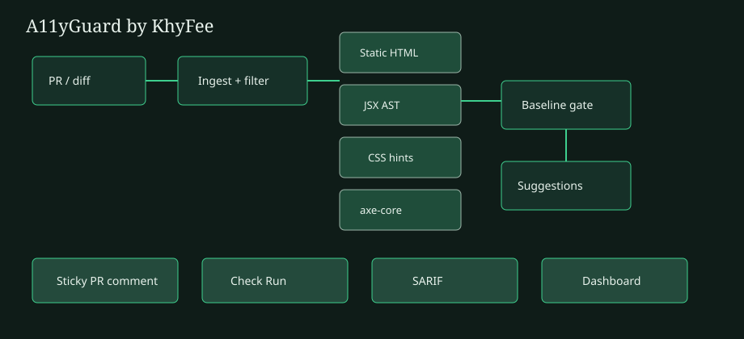

# A11yGuard

**Automated PR Accessibility Reviewer** by [KhyFee](https://github.com/KhyFee).

Catches WCAG regressions in frontend PRs: static HTML rules, JSX/TSX AST, optional axe-core on a preview URL, sticky PR summaries, and **one-click GitHub suggestion** fixes. Deterministic rules always run; LLM enrichment is optional.

Developed privately before this public release — commit history reflects open packaging, not a simulated multi-month timeline.

## Quick start

```bash
npm install
npx playwright install chromium
npm run demo
# inspect .a11yguard/report.{md,json,sarif}
```

## GitHub Action

```yaml
name: a11y
on: pull_request
permissions:
  contents: read
  pull-requests: write
  checks: write
jobs:
  review:
    runs-on: ubuntu-latest
    steps:
      - uses: actions/checkout@v4
      - uses: KhyFee/A11yGuard@v0.1.0
        with:
          fail-on: error
          fail-on-new: true
          sticky-comment: true
          post-review: true
```

## CLI

```bash
npx @khyfee/a11yguard doctor
npx @khyfee/a11yguard review --dir ./src
npx @khyfee/a11yguard review --diff fixtures/sample.diff
npx @khyfee/a11yguard demo
```

## Architecture



## Config

See [`.a11yguard.yml`](.a11yguard.yml). Baseline fingerprints keep PRs focused on **new** regressions.

## Limitations

Contrast from CSS-only diffs is approximate. Prefer `axe: true` + `preview-url` for real contrast/landmark checks. Not a legal WCAG certification.

## License

MIT (c) KhyFee
